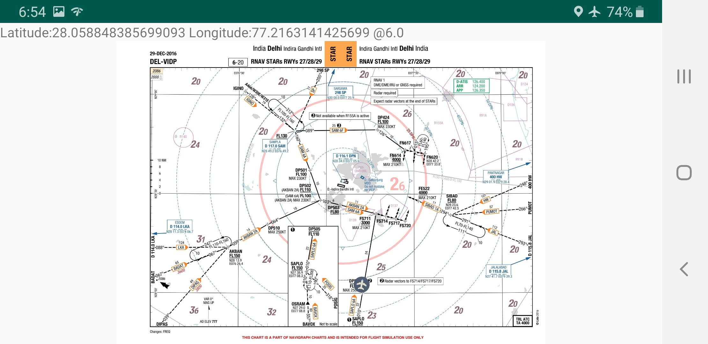
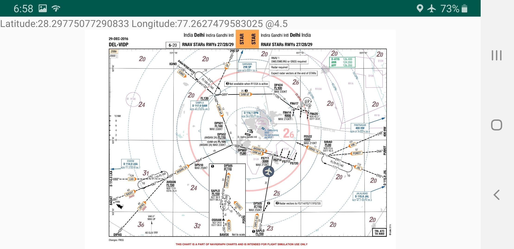
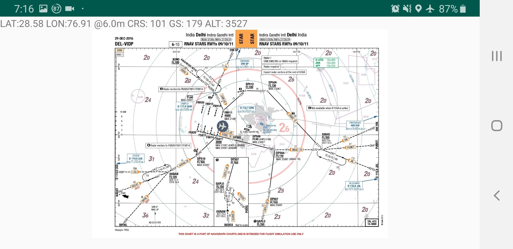
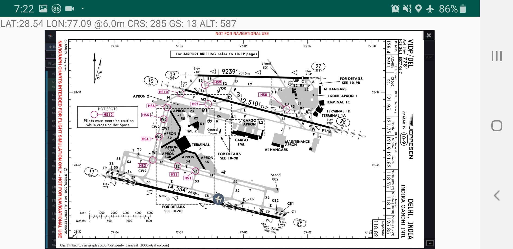

# ImgMap

Georeference aeronautical charts (approach plates, STARs, SIDs, VFR charts) and
use them as a GPS moving map. Built with Flutter for Android, iOS, macOS,
Windows, Linux and the web.

**Not for navigation.** Positions are only as good as the control points you
enter and your device's GPS.

## How it works

1. Add an airport by ICAO code.
2. Add a chart image (photo, screenshot or scan) for it.
3. Zoom in and tap points on the chart whose coordinates you know, such as
   fixes, VORs or runway thresholds, then type their coordinates. Most chart
   notations are accepted: `N28°34.12'`, `283407N`, `28 34 07 N`, `28.5687`.
4. Open the chart. Your position and track are drawn on it.

Two points are enough to fix scale and rotation. With three or more, the app
fits a full affine transform, which also corrects skewed or unevenly scaled
scans, and shows the error at each point so a mistyped coordinate stands out.

## Charts from the AIP

AIP charts come from the **ImgMap backend** (the `imgmap-backend`
repository), never from the eAIP directly. The backend reads each country's
eAIP once per AIRAC cycle, mirrors the chart PDFs, georeferences them, and
publishes everything as static files. However many people use the app, the
eAIP sees one visitor.

- **Getting charts.** Add an airport (for India, ICAO codes starting VA, VE,
  VI or VO) and the chart list opens for the edition in force. Only charts
  the backend could georeference are offered. Each one downloads (checked
  against its published hash), is rendered on the device, and gets the
  backend's control points.
- **Improvements arrive by themselves.** The backend publishes a revision
  number with each chart's georeferencing. When it improves a chart, the
  app picks up the new points the next time that airport's chart list
  opens. Points you placed or edited by hand are never replaced.
- **"You're here".** Charts whose area contains your current GPS fix are
  marked with a location badge and listed first, both among your charts and
  in the AIP chart list. A simulated flight doesn't count.
- **Countries come from the backend** (`v1/countries.json`, cached for
  offline use). A country added there appears in the app without a
  release. See the backend's README for how georeferencing works and how
  to add a country.

Always open an automatically georeferenced chart and check that its markers
sit on the grid lines or fix symbols before relying on it.

### Pointing the app at a backend

The app reads `https://charts.daniyaalkhan.com/` by default
(`backendBaseUrl` in `lib/src/aip/backend.dart`). To use another, set it at
build time:

```sh
flutter build apk --dart-define=IMGMAP_BACKEND=https://data.example.com/
```

For development, serve a local pipeline run over USB. Debug builds allow
plain HTTP to `localhost` only:

```sh
python3 -m http.server 8766 --directory ../imgmap-backend/out
adb reverse tcp:8766 tcp:8766
flutter run --dart-define=IMGMAP_BACKEND=http://localhost:8766/
```

## En-route map

The route button on the airports screen opens an airway map for the chosen
country, built by the backend from its AIP route tables (ENR 3.x). For
India that's 525 routes, 931 points and 2,161 segments. It's a single small
download (about 300 KB), cached for offline use.

- Routes are coloured by type (conventional or RNAV). Navaids, compulsory
  and on-request points have their own symbols, and labels thin out as you
  zoom out.
- Tap a segment for its track, distance, levels, MOCA, class and width, or
  a point for the routes through it. Search finds fixes, navaids and
  routes.
- Your position is shown with follow mode. The plane button simulates a
  flight along a route.
- **Self-checking.** Every segment's published length and track is
  compared with its coordinates; mismatches are drawn dashed red and
  explained when tapped.
- When a newer AIRAC edition comes into force, the map says so and offers
  an update.

## Trying it without a phone

Run the web build and choose **Try the demo**, then **⋮ → Add demo chart**.
The demo chart is fictional and deliberately rotated. Each fix has its
coordinates printed next to it, so you can georeference the chart yourself.
On the map screen, the ✈ button flies a simulated aircraft around the chart.

```sh
flutter run -d chrome          # or: flutter build web && serve build/web
```

In the browser, charts are kept in memory only and are lost on reload.

## Development

```sh
flutter test       # geo math, coordinate parsing, storage, full UI flow
flutter analyze
```

Georeferencing and eAIP parsing are tested in the backend repository.

| Path | What |
|---|---|
| `lib/src/aip/` | Backend client, chart listing, download and import |
| `lib/src/pdf/` | PDF rendering |
| `lib/src/geo/` | Projections (Mercator, UTM), control-point fitting, coordinates |
| `lib/src/data/` | Chart library; file storage on native, memory on web |
| `lib/src/location/` | GPS permission/stream handling and the flight simulator |
| `lib/src/ui/` | Screens and the shared zoomable chart viewport |
| `tool/make_demo_chart.py` | Regenerates `assets/demo_chart.png` |

The original 2019 native Android (Java) version is in the git history before
the Flutter rewrite.

## Screenshots (original Android version)

STAR into Delhi Int'l Airport (VIDP):







